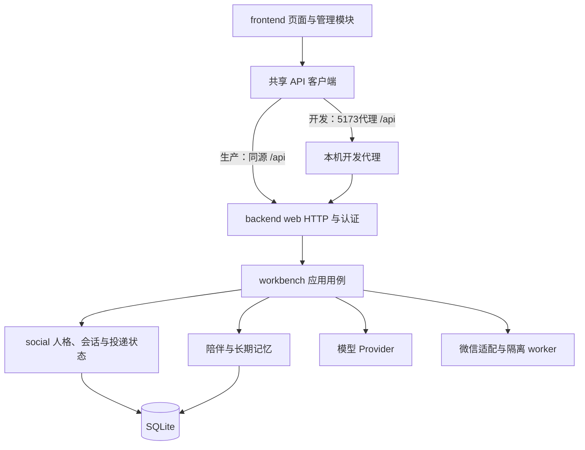

# 项目结构与技术栈

2026-11-18。本次保持原生前端与 Python 后端，完成源码、开发服务、构建产物和 HTTP 层分离，未改写聊天规则或切换模型／微信通道。

```text
WeChatAgent/
├── frontend/
│   ├── src/              页面、ES Modules、样式
│   ├── tools/            开发代理、构建与检查
│   ├── tests/            前端测试
│   └── dist/             生成的静态发布资源
├── backend/src/wechat_agent/
│   ├── web/              HTTP、认证、JSON与静态资源边界
│   ├── workbench/        应用用例与管理接口
│   ├── social/           会话、人格、账本与投递状态
│   ├── providers/        模型协议与凭据生命周期
│   ├── bridges/          微信等平台适配
│   ├── companion_vendor/ 上游领域模块与许可
│   └── assets/           分词资源、许可、生成的前端产物
├── scripts/              Windows原生worker与诊断工具
├── tests/                Python单元与集成检查
├── requirements/         平台可选依赖锁文件
├── docs/                 当前说明、历史记录与证据
├── research/             上游参考资料，不是运行源码
├── .state/               本机账本与加密凭据，不发布
├── .build/               临时产物、重构备份与检查输出
└── pyproject.toml        工作区唯一Python构建与依赖入口
```



## 实际使用的技术

| 层次 | 技术与当前版本 | 用途 |
| --- | --- | --- |
| 前端 | HTML5、CSS变量、原生 JavaScript ES Modules | 工作台、管理页、日夜主题 |
| 前端工具 | Node.js 24.18.0／npm 11.16.0（本机）；要求Node >=22 | 独立开发服务器、构建、测试；没有第三方npm依赖 |
| 后端运行时 | Python 3.12.9（本机）；声明 >=3.11 | 应用服务与CLI |
| HTTP服务 | Python asyncio、自有受限HTTP/1.1 transport | 本机JSON API与静态发布；未使用FastAPI、Flask或Django |
| 模型框架 | ai-agent 0.3.0、现有 Runtime／Provider 适配 | 模型调用、上下文、任务生命周期 |
| 出站HTTP | httpx 0.28.1 | 模型／可选协议请求 |
| 数据 | Python sqlite3／SQLite、事务、持久inbox/outbox | 会话、草稿、投递记录、记忆与管理配置 |
| 凭据保护 | Windows DPAPI与本机单实例租约 | 当前Windows用户加密和账本所有权 |
| 微信桥 | ctypes、Win32／原生内存适配、隔离Python子进程 | 固定微信4.2.0.13接收与前后台发送 |
| 解码 | cryptography 50.0.2、zstandard 0.25.0 | 可选微信本地库读取 |
| 媒体 | Pillow 13.0.0、av 19.0.2、silk-python 0.2.9、faster-whisper 1.2.1 | 图片处理、语音解码与本机转写 |
| Python工程 | setuptools 84.0.0、wheel 0.48.0、pytest 9.1.1、Ruff 0.16.1 | 打包、检查与测试 |
| 前端检查 | Node test runner、VM页面冒烟 | API认证、代理隔离与页面行为 |

依赖版本以根 `pyproject.toml`、`requirements.lock`、平台锁文件及 `frontend/package-lock.json` 为准。ClawBot／qrcode 是已保留但未启用的可选路线，不属于当前普通好友收发链路。

## 边界与启动

- 前端只操作页面及调用API，不读取SQLite、微信进程或本机凭据文件。
- 后端业务路由不再指定HTML源文件与脚本顺序；生产静态路由来自构建清单。
- `web/server.py` 管理HTTP生命周期、大小／时限、Bearer、Host与Origin检查；`web/validation.py`处理严格JSON；`console.py`及工作台管理路由负责业务调用。
- 开发时前端5173和后端8765独立运行，经本机代理保持浏览器同源，不启用宽泛CORS。
- 生产先构建前端，再打包／启动Python服务；无Node运行时依赖，原CLI与数据目录不变。
- Wheel包含前端发布资源；真实微信原生桥仍需要工作区的`scripts/`和受支持的Windows环境，本次未制作独立桌面安装包。
- 原生worker继续在工作区`scripts/`运行，根路径改为向上发现，不再依赖固定父目录层数。

本次没有把所有业务类重新拆成微服务；SQLite仍由单个后端进程持有，避免多个发送进程争用账本。`workbench/service.py`和`companion.py`仍是较大的应用模块，可以按具体功能继续细分。

开发步骤见 [前端](../frontend/README.md)、[后端](../backend/README.md)；接口见 [API](API.md)。
