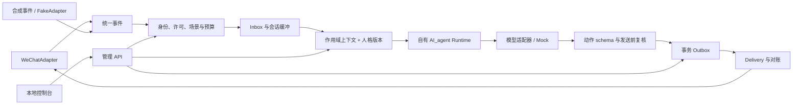

# WeChatAgent 可行性与执行计划

更新日期：2026-10-28（Asia/Shanghai）。需求基线：`../PROJECT_PLAN.md`。参考评估：`REFERENCE_REVIEW.md`。

本文是基线的执行细化。H0 研究、H1 传输、H2 认证生命周期与 H3 完整 Runtime 本机对话已通过各自验收；H4a 真实订阅基础连接**已通过**，H4b 真实刷新待自然观察。最新实现状态见 [H4 记录](H4_IMPLEMENTATION.md)。

后续澄清：本机个人自用不应凭空记为等待商业申请。首次 [Hermes 订阅接入评估](HERMES_SUBSCRIPTION_REVIEW.md)之后，用户已指定优先研究并规划该路线；当前 Codex 与 SIWC 的状态分别记录。

当前 H1–H3、H4a 与 S1–S4 各切片已通过，真实刷新单列观察。2026-10-28 已完成本机微信 4.2.0.9 x64 与桥接候选调查，下一项为 W1 只读 UI 控件探测；真实收发另行验收。见 [桥接核验与计划](WECHAT_BRIDGE_REVIEW_2026-10-28.md)。原 [Hermes Codex 实施计划](HERMES_CODEX_PLAN.md)保留模型路线与各阶段证据；SIWC 保留为对照。

H4 当前补充：账号目录与分步验收入口已实现；首次直连收到地区拒绝，随后按用户指出的代理配置问题修复路由。经实际使用的 Hiddify `127.0.0.1:12334` 已完成登录与账号目录查询，修复缺失 Content-Type / response.metadata 的兼容后，三个独立进程的真实短文本请求均通过。只复验受影响的关键场景，详见 [H4 记录](H4_IMPLEMENTATION.md)。

## 1. 结论与交付范围

**Codex 订阅与自有框架的本机文本闭环已接通。平台无关的社交核心、人格与控制台在工程上可行；微信能力与真实群场景需分别验证。**

用户已确认复用 `D:\qieehy\AI_agent`，无需另建 Agent 执行循环。用户补充希望广泛参考 GitHub 的 QQ 等项目，优先评估 Prompt、人格及前端。本计划采用这些意见，先降低通用部分的不确定性。

| 能力 | 可行性判断 | 当前证据 / 未满足条件 |
| --- | --- | --- |
| 离线社交核心、人格配置、作用域、限频与投递状态机 | S1–S4 子集已验收 | 已有持久账本、人格版本、合成私聊与被动群预算；主动调度和完整管理功能仍待实现 |
| 本地控制台与合成对话沙盒 | S2–S4 已验收 | 工作台、人格、回放、群沙盒及显式真实预演可用；不是完整生产管理端 |
| Codex 主人本机文本请求 | H4a 已通过 | gpt-6.1-sol 直接调用、Runtime 中文人格和独立进程恢复均通过；H4b 待观察 |
| SIWC 主人请求（对照路线） | 本轮不实施 | 保留原 OAuth/Responses 合同；尚未登录与实测 |
| 微信收、发、稳定身份与回执 | 环境与候选已调查，能力未实测 | 本机 4.2.0.9 x64；版本绑定桥未覆盖；下一步 UIA 只读探测，见独立报告 |
| 群友消息触发 Codex 判断、回复 | 场景核验与端到端验证未完成 | 模型连接、社交行为、微信投递独立验收；不由本机订阅成功推定完成 |
| 群友消息触发 SIWC 自动判断、自动回复（对照） | 原 SIWC 路线 BLOCKED | 原判断仅针对 SIWC，不机械套用到 Codex |
| 长期无人值守与长期账号稳定 | 暂无结论 | 小样本 PoC 和 48 小时观察都不能证明长期稳定 |

SIWC 对照项依据 [官方条款第 2、4 节](https://openai.com/policies/sign-in-with-chatgpt-terms/)与 [Quickstart](https://developers.openai.com/siwc/quickstart)。该项判断针对 SIWC 的群触发方式；当前 Codex 场景另记状态，不用它阻止 H1–H4。

第一可交付目标调整为：**Codex provider + AI_agent + 本机 CLI 文本对话及可复现验收**。之后推进离线社交核心、人格与控制台，再整合微信私聊和群场景；后续能力分别记状态。

## 2. 首轮调查记录（历史，后续进度见第 9 节）

- 读取完整 `PROJECT_PLAN.md`；当前目录最初只有该文档，尚不是 Git 仓库。
- 用户确认 `AI_agent` 为自有框架；只读查看 Runtime、模型合同/客户端、会话协调、会话存储、组合入口、日志配置及部分测试文件清单。
- 复核 SIWC Quickstart、Models and inference、Preview limitations 及条款页面。
- 抽样研究 MaiBot、AstrBot、SillyTavern、Koishi；证据强弱及未固定版本的限制见参考评估。
- 只读环境检查显示 Windows 构建 `10.0.26200`、X64；按 `Weixin/WeChat` 进程名未取得运行进程及版本。这不能证明微信未安装或未登录。
- 未读取 `.env`、用户聊天库、认证缓存或账号资料；未安装依赖、执行参考程序、登录 OAuth、调用模型或收发消息；未运行框架测试。

框架 Git 元数据命令在当前环境返回 Permission denied，未取得 commit/status；以下以实际读取文件的 SHA-256 标记证据，而非声称代码已提交或工作区干净：

| 本地文件 | SHA-256 |
| --- | --- |
| 原始 PROJECT_PLAN.md（本轮追加前） | `C32B2DEF615B5604399E33B17C9D1701D37DDF49499C0CA5B06CCABF08DF6043` |
| AI_agent/runtime/runtime.py | `93B6D4F74A394709CA09A7FF1D45CFE658F26FCD988B3A1BC256F4218776C534` |
| AI_agent/llm/client.py | `6CC20C44315918AC9ABDB0CAACCD4FE32212B7B17C09065BEE940A5A6B858F6D` |
| AI_agent/memory/session_store.py | `FCEE8C73E8317524C4AA9BFE909D74924791874B2D15BAF1E5E2EFEB7FE38186` |
| AI_agent/main.py | `0452C4928B3D218138669C4C4EF25A4F60C2845172360FE7F51F7E2A53D7E247` |

## 3. 自有框架的适配评估

下述保留首次框架静态发现；H3 已通过应用侧组合/适配器运行锁定版本的完整 Runtime，具体证据见 H3 记录。相邻源码已有后续变化，未自动升级本项目的框架依赖；没有修改 AI_agent 原文件。

| 实际代码位置 | 已有能力 / 差距 | 实施决定 |
| --- | --- | --- |
| `AI_agent/runtime/runtime.py`：Runtime 构造、run_async | 可注入异步模型 callable；有状态、事件、会话 lease、取消路径 | 复用 Runtime，建立专用组合入口；不启动原 CLI 作为机器人后端 |
| `runtime/session_coordinator.py` | 单进程、单事件循环内按 session 串行；默认冲突拒绝 | 复用为内部执行锁；外层按会话有界缓冲/工作队列，默认一个应用实例；不声明多进程锁保证 |
| `llm/client.py`、`llm/models.py` | 当前走 Chat Completions；内部结果有 AssistantMessage / LLMResult | 新增 Codex Responses callable，把完整流转换为现有结果；不复用旧请求体和通用 429 重试策略 |
| Runtime._init_state | 现有 system prompt 进入历史 | 适配器只把受信系统配置映射到 instructions/developer；聊天中的伪造 role 文本不能提升角色权限 |
| `main.py`：build_runtime | 默认创建工具注册表、EmbeddingRouter、模型客户端与模式组件 | 建立空工具注册表和明确配置的 no-tool router；不调用此默认工厂，不启用 planner/critic，不初始化 embedding worker |
| `memory/session_store.py` | 已有同步 SQLite 会话保存/读取 | 可复用序列化思路，不能当作带权限的 inbox/outbox；设计有界 DB worker，在其所属线程创建/关闭连接，不能把现有连接直接跨线程使用 |
| `memory/manager.py`、Runtime._init_state | get_or_create 本身不自动 load；Runtime 使用缓存上下文 | 明确恢复与草稿上下文所有权；防止重启丢历史或将未发送草稿当成已说过 |
| Runtime 的输入日志、`observability/__init__.py` | 可观测事件丰富；现有路径记录输入前缀，日志配置含诊断信息 | 接入真实消息前移除/过滤正文、任意异常文本和敏感局部变量；只保留关联 ID、状态和原因 |
| 已查看目录与调用位置 | 未发现面向此项目的持久主动任务 scheduler、微信收发和投递账本 | 新增应用服务，资源生命周期集中管理；不把“未发现”扩大成全仓库不存在的断言 |

### 3.1 两个容易被低估的适配问题

**草稿与已发送历史不同。** Runtime 的回答是候选内容，权限复核可能拒绝，微信也可能未确认发送。ContextBuilder 必须从消息账本构建“已收到/已确认发出”的历史；候选决策以独立记录保存，不把 Runtime 缓存直接作为社交事实库。优先为每个批次创建受控临时 MemoryManager，完整作用域历史经适配层装入，再在会话锁内执行；任务结束释放临时上下文。正式实现前测试这一路径与现有 Runtime 的装配，若需扩展公共接口，记录单独改动。

**完成模型推理不等于可以发消息。** Codex callable 内部消费 SSE，只有收到显式成功终止事件且校验完整结果后才返回 LLMResult；具体合同见 [Codex 研究](HERMES_CODEX_RESEARCH.md)。后续微信整合仍须解析动作、复核权限、原子提交 outbox，再由独立 delivery 发送。

## 4. 平台无关边界与资源所有权

此图是完整社交应用的拟议结构；H3 只接通了本机对话、实际 Runtime 和 Codex provider 分支，完整社交账本/策略/投递尚未接线。QQ 项目只提供设计和源码参照；第一阶段不新增 QQ 账号连接。

- **Application**：持有 Runtime、接入通道、模型会话、DB worker、调度器及有界队列，负责统一启动、取消和关闭。
- **Runtime**：只拥有一次推理运行和临时工作上下文，不直接接触真实发送凭据。
- **Repository/DB worker**：拥有 SQLite 连接、事务、状态转换及持久版本；决策与 outbox 同事务提交。
- **Policy**：拥有账号/目标绑定、同意、场景许可、限额与策略版本；人格和聊天不能修改这些权限。
- **Delivery**：拥有单次提交和证据对账；无法确认的提交进入 UNCONFIRMED，不自动创建新动作重发。
- **Control API**：使用同一策略和仓库接口；界面审核不旁路限频、TTL 或撤销。

M1 先单进程部署；多实例协调、账号池及分布式调度均不进入本轮设计。服务暂停时先阻断新授权，取消相关模型/待发任务并更新持久状态。已进入外部发送后无法保证撤回，必须如实记录提交边界。

建议正式编码使用独立 Python 包名 `wechat_agent`，通过固定版本的本地框架依赖导入；避免把本项目也做成顶层 `llm/runtime/memory` 而与现有框架冲突。依赖和测试环境在实现时建立；不通过全局 sys.path 或复制整套框架来接线。

## 5. 执行顺序、工作量与出口

当前先推进 H1–H4 / 独立 M1-B，微信 M1-A 不再是其前置依赖；整合阶段要求两侧分别通过。M1-C 的离线核心及 UI 沙盒同样可独立开发，不以此提前宣告正式整合验收通过。

以下保留首次全项目估算供范围对照，尚未随 Codex 细化重估。当前模型路线采用新计划的 5–8 人日预算，与下表存在重叠，不直接相加。均按熟悉 Python 异步和前端的单人全职投入粗估；账号准备、许可回复和不受支持微信版本的适配等待另计。

| 阶段 | 任务与交付物 | 出口 / 依赖 | 估计 |
| --- | --- | --- | --- |
| M0-参考与框架 | REF-01–05 定点阅读；固定版本；框架最薄适配合同；原创 persona/schema；页面与 API 草案 | 对每模块明确复用/重写/不用，有证据和许可清单；尚不能宣布 M0 全过 | 3–5 人日 |
| M0-外部路线 | 微信版本与候选能力/许可矩阵；当前模型路线的账号与触发场景清单 | 微信和模型分别记录；未知项写待核验，实际外部障碍注明原因 | 1–2 人日 |
| M1-A | 不接模型的微信 PoC；固定文本往返、群接收、手动群发、主动任务、故障恢复 | 完整执行基线第 10 节的 20/10/20/3/5 条样本及故障用例；两端对账 | 2–4 人日 |
| M1-B | Codex 独立 OAuth、受保护存储、目录、Responses 完整流及恢复 | H4a 的基础调用与 H4b 的真实刷新分别记录；不接微信 | 原粗估 2–4；当前按 H1–H4 细化范围估算 |
| M1-C 离线核心 | FakeAdapter、消息账本、权限与作用域、临时 Runtime 上下文、人格、限频、调度、故障注入和回放 | ≥30 组标签场景；权限/隔离/幂等全过，社交标签 ≥80%；mock 结果只证明离线行为 | 6–9 人日 |
| UI | 本地管理 API、五页精简控制台、人格预览、草稿/状态/撤销及诊断 | 断线不误报送达；并发配置不覆盖；令牌不进前端；使用 FakeAdapter 可演示全流程 | 4–6 人日 |
| M1-D | 主人回复 → 授权主动私聊 → 仅在场景许可通过后试验群模型行为；运行手册 | 适用能力完成 48 小时受控观察；群未获准仍记 BLOCKED | 2–3 人日 + 48 小时观察 |

**首次全项目粗估为 20–33 人日，另有 48 小时观察；含缓冲约 24–43 人日。** 此为历史范围预算，当前不作最终排期承诺；在 H4a 和微信选型后重新估算。采用已有代码不保证节省时间，跨语言移植、许可审查和裁剪均可能抵消收益。

若采用教学配对、由用户逐步写实现，上述全职估算不适用，应按可投入时间和每个纵向切片重估。AI_agent 原项目的教学规范在实际修改该仓库时继续适用；本次未修改该仓库。

### 5.1 第一个可执行切片

更新：本节定义的 S1 合成私聊闭环已经实现并通过 5 个关键场景，见 [S1 记录](S1_SOCIAL_CORE.md)。人格版本及三页本地工作台也已通过 S2 离线验收，见 [S2 记录](S2_PERSONA_CONSOLE.md)。S3 显式真实单轮人格预演也已通过，见 [S3 记录](S3_LIVE_PREVIEW.md)。S4 合成群被动策略也已通过，见 [S4 记录](S4_GROUP_SANDBOX.md)。以下保留原切片目标；下一步为本机微信版本及候选桥兼容性核验，真实群与微信接入仍未完成。

模型路线 H1–H3 与 H4a 已完成，H4b 真实刷新单列观察。以下为下一步社交核心的第一切片。

在源码审查与接口冻结后，先交付一个无需账号的闭环：

`合成主人事件 → policy → inbox → 固定 Mock 决策 → outbox → FakeAdapter → CONFIRMED`

同一切片必须覆盖：重复事件只形成一个动作、未知账号/会话拒绝、SILENT 无可发 outbox、撤销阻断待发、发送后崩溃进入 UNCONFIRMED。然后接真实 `AI_agent Runtime + Mock LLM`，核验无工具注册、无 embedding worker、无 planner/critic、无新 Agent 循环。最后再接人格编辑和回放 UI。

## 6. 可追踪任务与验收

下表整合任务尚未全部完成；H0 与 E-03/F-01 涉及的 H1–H3 切片已通过，历史研究与各阶段验收分别记录。F-05/F-09 的本机边界有 H3 证据，仍不能替代正式消息账本、权限和微信生命周期。待实现、待实测与实际外部阻塞分别记录，不把一条路线的阻塞扩展到其他任务。

| ID | 任务 | 依赖 | 核心验收 |
| --- | --- | --- | --- |
| F-01 | 固定 AI_agent 与参考文件版本，确定依赖导入和 no-tool 组合入口 | REF 审查 | 无默认 CLI、Shell、搜索、工具路由模型下载；空工具恶意调用被拒绝 |
| F-02 | 事件、Persona、Decision、Delivery schema | F-01 | 稳定账号/会话/消息 ID；非法动作/收件人字段/超长文本被拒绝 |
| F-03 | SQLite migrations、inbox/outbox、事务与恢复 | F-02 | 并发重复入站唯一；决策/outbox 原子；重启不重复创建动作；连接清理可测 |
| F-04 | policy、总暂停、同意撤销、预算与上下文版本 | F-02/03 | 推理前与发送前都复核；未知群零调用零发送；旧版本草稿取消 |
| F-05 | 作用域 ContextBuilder 与临时 Runtime memory | F-01/03 | 两账号、同名群、私聊与群均不串线；未发送草稿不当作已说过 |
| F-06 | 人格版本与 Prompt 区块装配 | F-02/05 | 样例不变事实；人格不能开权限；同一版本/输入可重建装配内容 |
| F-07 | 每会话缓冲、全局背压、主动调度 | F-03/04 | 3 秒窗口/10 秒最大等待有界；09–22 时段；漏跑不补刷；新入站取消主动草稿 |
| F-08 | delivery、回执与 UNCONFIRMED 对账 | F-03/04 | 提交前失败与提交后未知分开；不确定发送不盲重试；无自回复循环 |
| F-09 | 脱敏日志与资源生命周期 | F-01–08 | 正文/token 不入日志；退出停止接收、推理、调度、发送并关闭连接 |
| E-01 | 微信候选静态审查与版本矩阵 | M0 外部路线 | 不以只读数据库成功推定能发送；无来源/许可证据不进入候选 |
| E-02 | M1-A 真实 PoC | E-01 + 测试账号/目标 | 达到基线样本及接收端证据要求；当前环境待准备、尚未测试 |
| E-03 | Codex 适配与真实 M1-B，见 H1–H4 | 框架合同；真实阶段需独立登录，不依赖 E-02 | HTTP/SSE、刷新/429/5xx/断流/取消有证据；H4a/H4b 分别记录 |
| U-01 | 本地管理 API、认证和版本冲突 | F-02/04 | 回环监听、Origin 校验、配置乐观版本检查；冲突不静默覆盖 |
| U-02 | 五页控制台与 FakeAdapter 沙盒 | U-01/F-06/08/09 | 默认 fake 模式；状态与事实一致；人格预览默认合成数据 |
| V-01 | 回放、故障与端到端接线 | F-01–09/U-02 | ≥30 组；逐例标签、拒绝原因和调用次数；关键权限全过 |
| V-02 | 实环境观察、恢复/撤销手册 | E-02/03/V-01 | 48 小时适用范围内零错目标、错账号、重复副作用、串群 |

测试用 fake clock、确定性事件屏障和可控故障，不用真实等待来测试时段/退避；不为模拟 429 耗尽真实额度。离线测试默认断开真实 adapter/provider，真实测试须显式选择环境和测试目标。

H1/H2 已通过协议、真实 loopback HTTP、框架安装、Windows DPAPI/进程锁与认证验收；H3 补齐完整 Runtime、多轮、草稿确认、身份隔离、401 恢复和退出。H3 的 6 个关键场景已通过，做过一次 93 项整体回归；最终局部修正的验证范围见 H3 记录。真实认证与前端仍在各自阶段验收；后续避免重复无变化的细碎测试。

## 7. 参数、状态与门禁补充

- 原基线第 8.2 节群日上限为 20 条，第 10 节 M1-D 试验上限为 10 条；**测试期取更严格的 10 条/日**，不是两套任选规则。其余群间隔/配额、主动私聊 2 次/日及 4 小时间隔、120 秒草稿 TTL 均沿用基线的测试建议值。
- `account_id + conversation_type + conversation_id` 绑定作用域，并在需要共用命名空间时带上 platform。昵称、群名、模型输出和前端显示名称都不是权限键。
- 限频分“预留调用/发送额度”与“最终消费/释放”，防止并发检查同时通过；发送未知状态按已占用额度处理，避免不确定后继续刷屏。时段按 Asia/Shanghai，持久事件存带时区时间；单进程间隔用单调时钟，重启恢复用持久时间重新保守计算。
- 后端持久事实区分入站、候选决策、确认发出及未确认发出；记忆不得将未确认文本写成已发言。
- 微信真实发送依赖桥接审查、PoC 与目标账号匹配；本机 Codex 推理按 H4 独立验收。群场景核验与端到端测试未完成时，群策略继续使用合成场景开发。

## 8. 依赖用户的信息与决策

已确认：自有框架为 `D:\qieehy\AI_agent`；平台无关部分先广泛参考现有项目。其余信息按依赖阶段补齐，不阻碍当前的参考评估和离线设计：

| 需要的信息 | 最迟需要时间 | 缺失时推进范围 |
| --- | --- | --- |
| 真实微信完整版本/安装架构、测试账号及允许候选 | M0 外部路线出口前 | 继续 FakeAdapter、人格、状态机、控制台 |
| Codex 独立登录及当前账号可用模型 | H4 真实验证时 | H1–H3 可使用合成认证/模型；不需要先提交商业接入申请 |
| 主人稳定 ID、测试群 ID 与相应许可记录 | M1-A 的对应收发前 | 仅合成身份与固定本地模拟 |
| Codex 群场景的适用范围、群许可及能力证据 | 真实群模型试验前 | 本机主人功能与合成群继续；与原 SIWC 判断分开，不自动切 API Key |
| 人格偏好、主动主题、时段、配额和保留策略 | 人格/任务真实启用前 | 以基线建议值进行离线测试，所有真实主动任务默认未授权 |

这些信息按阶段补齐。H1–H3 与 H4a 已完成，后续平台无关开发无需先提供微信账号或群资料。

## 9. 完成标准与当前状态

| 范围 | 当前状态 | 何时可报告完成 |
| --- | --- | --- |
| 本次可行性分析、参考抽样及实施计划 | 已完成文档交付 | 文件存在、引用和任务依赖可复查；调查限制已记录 |
| H1 Codex 文本传输与本机演示 | 已通过本机验收 | 43 tests / 814 subtests、CLI、Ruff/pip check、框架 wheel 指纹均有证据 |
| H2 独立认证与凭据生命周期 | 已通过合成服务及本机系统验收 | 新增 44 tests，H1/H2 整体 87 tests / 846 subtests；真实账号仍未登录 |
| H3 完整 Runtime 与本机多轮 | 已通过关键验收 | 6 个关键场景通过；本机确认历史、会话/登录隔离、401 和退出有证据；完整社交账本尚未实现 |
| H4 账号目录与真实订阅验收 | H4a 已通过，H4b 待观察 | 经 Hiddify 完成授权、目录、三个短请求与独立进程登录恢复；真实刷新尚未发生 |
| M0 完整审查 | 部分调查，未通过 | 固定来源/许可、框架接口、实际微信与选定模型路线边界齐备 |
| 平台无关核心/人格/控制台 | S1 合成私聊、S2 人格与 UI、S3 真实单轮预演、S4 合成群被动策略通过 | S1–S4 见独立记录；真实群接线、主动调度、完整权限及对账界面仍需各自验收 |
| E-01 环境与候选桥调查 | 2026-10-28 调查完成，非兼容性通过 | 4.2.0.9 x64 本机证据与六个固定仓库已记录；W1 UI 控件探测待执行 |
| W1 微信控件探测 | 2026-10-29 W1-D 独立原始诊断完成，出口未通过 | Raw/Control 均只有 3 节点，无异常/截断；已排除仅快照过滤，下一项 W1-E 初始化路径评估 |
| W1-E 初始化路径 | 源码与本机静态匹配完成 | 确认写进程内存机制；4.2.0.9 磁盘 DLL 有一个优先候选，但运行时未验证；下一项 W1-F 受控验证器 |
| W1-F 受控验证器 | 授权的单次启用及恢复通过，聊天出口仍未通过 | 原主窗 0→1→0 对应 3→51（深度截断）→3 节点；恢复回读与独立只读复查通过，尚待深层聊天控件/身份验证 |
| whale_gril 参考评估 | 固定源码审查完成，未运行桥接 | 采用深层控件与数据库事件思路，改写文本重试/确认/身份绑定；下一项 W1-G1 有界结构探针，见 [改造计划](WHALE_GRIL_REVIEW_2026-10-30.md) |
| 微信真实能力、Codex 真实调用 | 微信未验证；Codex H4a 已通过 | 微信继续按 M1-A 独立验收；Codex H4b 真实刷新单列 |
| 真实群 Codex 自主交互 | 场景与端到端待核验 | 选定路线适用范围、群行为及投递验收均有证据 |
| 真实群 SIWC 自主交互（对照） | 原路线 BLOCKED | 不作为当前 Codex 开发的总状态 |
| 完整项目目标 | 未完成 | 基线最终验收全部适用关口通过，不能以部分交付代替 |
