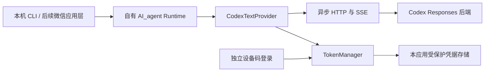

# Hermes Codex 订阅路线：接入方案与实施计划

更新日期：2026-10-27（Asia/Shanghai）。本计划落实用户指定的 Codex 优先路线；技术研究见[固定源码报告](HERMES_CODEX_RESEARCH.md)，产品总目标见 [PROJECT_PLAN](../PROJECT_PLAN.md)。H1–H3 已实现并通过本机验收，见 [H1](H1_IMPLEMENTATION.md)、[H2](H2_IMPLEMENTATION.md)、[H3](H3_IMPLEMENTATION.md)；H4a 真实订阅基础调用已通过，H4b 真实刷新待观察，见 [H4](H4_IMPLEMENTATION.md)。

## 1. 目标与选型

**先交付一个本机文本对话入口：用户独立登录 ChatGPT，WeChatAgent 的 Codex provider 使用订阅完成推理，并接入原有 AI_agent Runtime。** 达成后再推进微信、人格管理界面与社交行为整合。

这里“参考 Hermes”指参考其 `openai-codex` 的认证与 Responses 协议实现。运行核心仍为 `D:\qieehy\AI_agent`，本项目负责登录、模型适配和应用配置。官方 Hermes 文档明确列出 ChatGPT/Codex 订阅登录；当前源码实现值得采用，但本机账号能否正常调用要由真实验收证明。[Hermes providers](https://hermes-agent.nousresearch.com/docs/integrations/providers)

| 选择 | 本轮决定 | 原因 |
| --- | --- | --- |
| 模型路线 | 优先实施原生 Codex OAuth + Responses | 用户已指定；已有固定源码和离线协议证据 |
| Agent 核心 | 保留 AI_agent，注入异步 provider | 复用框架执行与取消机制，保持人格/社交层独立 |
| 运行形态 | 同一进程中的 Python 模块 + 简单 CLI | 当前只有本应用一个消费者，无需新增代理服务 |
| 认证入口 | 独立设备码登录；浏览器 PKCE 为后续兼容项 | 首个切片不依赖本机回调端口；设备码不可用时再补 PKCE |
| 模型选择 | 当前账号目录里的真实 slug，经调用验证 | 不从硬编码名称或旧缓存推定可用性 |
| SIWC | 保留对照资料，本轮不并行实施 | 与 Codex 的客户端、scope、端点合同分开 |
| Hermes Subscription Proxy / API Server | 不作为本轮接入方式 | 当前 Proxy 列出的适配器是 nous/xai；API Server 会运行 Hermes Agent |

Proxy 与 API Server 的差异及已支持上游见 [Hermes Subscription Proxy](https://hermes-agent.nousresearch.com/docs/user-guide/features/subscription-proxy)。

这条线完成后的可见效果：本机终端能够登录、查看连接状态、选择可用模型、通过 AI_agent 对话、退出；重启后可恢复本应用登录。使用 ChatGPT 订阅，无需额外配置 API Key 或购买 Nous Portal。

## 2. 已有证据与尚未完成的工作

| 项目 | 当前状态 | 能说明什么 |
| --- | --- | --- |
| Hermes 源码调查 | 已完成 | 固定提交 `e82bf01eec9bb58848209b07f0bc7d8895a39f9b`；18 份文本快照及哈希可复查 |
| 文本协议研究探针 | 19 项离线测试通过 | 合成事件能转换为真实 AI_agent 的 LLMResult，拒绝部分失败/不完整结果 |
| 原始 HTTP/SSE 传输 | H1 已实现，本机验收通过 | 43 项测试 / 814 子用例；包括真实 loopback 字节流、HTTP 错误、超时、取消和关闭 |
| 本应用独立 OAuth、凭据保护与刷新 | H2 已实现，合成认证验收通过 | H1/H2 共 87 tests / 846 subtests；真实 Windows DPAPI/进程锁已测，真实账号未登录 |
| 完整 AI_agent Runtime 接线 | H3 已实现，本机关键验收通过 | 实际 Runtime + 合成认证/HTTP 多轮；6 个关键场景通过，做过一次 93 项整体回归；真实订阅未调用 |
| 当前账号模型目录与订阅推理 | H4 工程入口及代理修正完成；等待浏览器授权 | 首次直连返回地区拒绝；显式采用用户 Hiddify 后已取得设备码，真实目录/模型请求仍待验收，见 [H4](H4_IMPLEMENTATION.md) |
| 微信收发、群友问题回复 | 后续独立验收 | 订阅接通只能解决模型连接部分，不能替代消息识别、行为决策与投递验收 |

状态约定：`待实现`表示代码尚未完成，`待实测`表示缺少真实证据；只有实际失败且需要外部条件变化时才记录具体阻塞原因。此前 SIWC 群触发的 BLOCKED 不直接变成整个 Codex 路线的状态，也不据此阻止本轮本机对话开发。

## 3. 最小架构与职责

已建立 `src/wechat_agent/` 独立包，H1 传输、H2 认证、H3 完整 Runtime 和本机 CLI 已接线；真实订阅在 H4 验收：

| 模块 | 单一职责 | 必须守住的接口 |
| --- | --- | --- |
| `providers/codex/auth.py` | 已实现设备码、有界轮询、换码与刷新 | 用户浏览器参与真实登录在 H4；合成认证端点按阶段验收 |
| `credentials.py` / `token_manager.py` / `protection.py` | 已实现 Windows 用户级保护、原子保存、单一刷新所有者 | DPAPI、进程锁、持久刷新标记、保存失败、退出竞态与重启已测 |
| `providers/codex/transport.py` | 异步 HTTP、SSE 字节解析、时限及资源关闭 | HTTPS 固定上游；不把 token 随重定向发送到别处；本地模拟只使用合成凭据 |
| `providers/codex/provider.py` / `catalog.py` | 文本推理与实时账号目录已实现 | `messages, tools=None → await LLMResult`；空工具集合；目录只采用当前账号服务端返回的可见 slug |
| `bootstrap.py` / `cli.py` | demo、auth、chat mock/live 及完整 Runtime 组合已实现 | 实际多轮 CLI；退出协调 Runtime、provider 与凭据；不启动默认工具或后台 worker |
| `chat.py` / `context.py` / `framework.py` | H3 会话隔离、草稿确认、临时文本记忆及离线分词初始化 | 只保存已确认往返，身份切换阻断旧上下文；完整消息账本仍在后续社交层 |

HTTP 内部消费事件流，但对 Runtime 只返回一次完整结果。人格与受信指令由应用层传入；provider 不硬编码 Hermes 的身份 Prompt。H3 已管理本机候选回复与已确认 RAM 历史；完整入站/发送账本、社交决策和微信投递仍由后续应用层实现。

框架已通过本地 wheel 正常安装到独立环境；原 package discovery 漏包，在本项目构建暂存区增加 observability/prompts，并在 `framework.lock.json` 记录打包修正与源码哈希。原框架未修改，生产导入不采用研究探针的临时 sys.path。详情及复现步骤见 H1 记录。

## 4. 实施阶段与验收出口

顺序为 **H1 → H2 → H3 → H4**。已完成的源码研究记为 H0。H1–H3 可以在无真实账号、无微信的条件下完成；H4 只需用户参与浏览器登录，不等待微信 PoC。

| 阶段 | 要完成的工作 | 可检查的交付物与验收 | 估计人日 |
| --- | --- | --- | --- |
| H1：包结构与异步传输（已完成） | 独立环境/依赖锁、文本 provider、异步 HTTP/SSE、合成命令演示 | 43 项测试与 814 子用例通过，CLI 与可复现 wheel 哈希通过；详见 H1 验收记录 | 原估 1.5–2 |
| H2：认证与凭据生命周期（已完成） | 设备码状态机、受保护存储、刷新、绑定、logout、状态查询 | 新增 44 项认证测试；整体 87 tests / 846 subtests 通过；真实账号连接仍在 H4 | 原估 1.5–2.5 |
| H3：自有框架完整接线（已完成） | 专用 Runtime 工厂、无工具执行路径、受控临时上下文、CLI；将 H1/H2 接在一起 | 6 个关键场景通过：实际多轮、草稿确认、身份隔离、401 恢复、取消退出、安装后离线启动；详见 H3 记录 | 原估 1–2 |
| H4：真实订阅验证与交接（H4a 已通过） | Hiddify 路由、独立登录、账号目录与 SSE 兼容已落实 | provider / Runtime 中文人格 / 独立进程登录恢复均通过；H4b 真实刷新待观察 | 工程与基础验收完成，另计自然令牌周期等待 |

合计约 **5–8 人日**，按熟悉 Python 异步的单人全职投入粗估；考虑协议差异和 Windows 存储/打包问题，预留后约 **6–10 人日**。这是模型路线预算，不是微信项目总工期；账号交互和自然令牌周期等待另算。若采用教学配对，按实际投入重新估算。

### H1：第一批任务

1. 验证 AI_agent 的包安装与导入，建立本项目独立包及测试入口，固定依赖与源码指纹。
2. 定义 `ProviderError` 分类、超时/取消和 `aclose` 所有权；错误不伪装成普通 assistant 回复。
3. 用本地 HTTP 服务实现“请求文本 → 分片 SSE → 完整 LLMResult”的闭环。
4. 覆盖最有风险的失败：HTTP 200 后断流、终止状态不匹配、commentary 混入、工具事件、响应 ID 串线、超长输入/输出、取消后连接泄漏。

第一批交付的演示只使用合成凭据和消息，能观察请求数及关闭行为。19 项研究测试作为回归证据保留；HTTP 字节和完整 Runtime 的验收需新增有实际意义的集成测试。

### H2：登录和恢复规则

- 默认设备码登录。OpenAI 官方认证说明指出设备码登录可能需要在 ChatGPT 安全设置或工作区权限中启用；遇到该提示按账号设置处理，不转写成“必须申请商业资格”。来源：[OpenAI 认证文档](https://learn.chatgpt.com/docs/auth)。
- 凭据保存在本应用专属目录，通过 Windows 当前用户级保护封装；写入仓库的只有无秘密配置示例。合成令牌用于测试，日志与状态输出不含 token 或一次性登录码。
- 单进程持有刷新所有权；进程间锁阻止同一凭据存储被第二个写入者并行刷新。一个调用者取消等待不丢弃已在执行的令牌轮换保存；应用退出有明确有界清理。
- 本地 logout 删除本应用凭据并使未完成登录/刷新失效。若后端撤销接口未经确认，界面只报告本地退出成功，不声称已撤销服务端授权。
- 设备码失败、403、429、存储失败分别给出可操作状态；不自动读取其他应用的缓存、切账号、切模型或切付费 API。

### H4：真实验收分两层

**H4a：本机订阅调用已接通。** 需同时具备以下证据：

1. 本应用独立登录成功，取得当前账号目录并选定真实模型 slug。
2. 3 次请求各有明确完成事件：一次直接 provider 短文本检查，一次通过真实 Runtime 检查简单人格/中文回复，一次在进程重启后通过 Runtime 调用以检查登录恢复。
3. 记录应用/框架/参考提交、模型、时间、耗时、响应状态、HTTP request ID（若有）、真实返回的 usage（若有）；认证和原始聊天内容不进诊断日志。
4. 失败或取消没有可发送的半截回复；未发生工具调用或其他隐式模型请求。已验证的离线错误恢复用例随证据一起保存。

**H4b：真实刷新恢复已验证。** 在正常令牌生命周期中观察一次刷新及轮换保存，之后重启仍可调用；不修改 token、伪造过期、反复刷新或耗尽额度制造测试。H4a 完成而 H4b 尚未观察时，明确报告“订阅已接通，真实刷新待观察”，不宣称无人值守稳定。

真实 429/服务端故障不主动制造；用合成服务测试恢复逻辑，如后续自然遇到再补证据。三个成功请求只证明基本可用，不能外推出全天候可用、固定配额或长期稳定。

## 5. 错误处理与初始运行策略

| 情况 | 第一版处理 | 验收重点 |
| --- | --- | --- |
| 未登录或授权终止 | 停止模型调用，给出独立登录入口 | 没有后台无限登录/刷新循环 |
| 设备码轮询 403/404 | 仅按该端点合同作为等待处理，有总时限 | 不套用到推理和刷新端点 |
| 推理 401 | 允许一次受控凭据刷新；仅明确未成功的请求可重试一次 | 终止错误立即转为需重新登录；无递归重试 |
| 推理 403 / 模型不可用 | 显示账号或模型不可用，返回选择/诊断入口 | 不把它当成继续轮询，也不静默换路由 |
| 429 | 记录可用的服务端重试时间，暂停后续调用 | 初版不自动重放当前请求，不把暂停当作账号失效 |
| 超时、5xx、断流、结果不完整 | 当前请求失败；输出是否已生成未知时不自动重放 | 避免恢复循环重复消耗额度；用户可明确重新发起 |
| 刷新结果保存失败 | 标记认证状态需处理，停止新调用 | 不继续依赖只在内存中的新 token；不重放可能已消费的旧 refresh token |
| 协议/字段变化 | 返回兼容性错误并保留无秘密诊断 | 不把未知事件或半截文本猜成正常答案 |

初始全局推理并发设为 1，限制队列、请求总时长、输入与输出大小；这些均作为可测试配置。额度信息缺失时显示未知，不显示“无限”或虚构剩余量。上游仍可能改变接口；固定参考版本是复现手段，不是服务端稳定保证。

## 6. 如何回到微信项目

H4a 通过后，E-03/M1-B 可以记录“Codex 基础订阅调用通过”，H4b 单列恢复状态。原 M1-A 微信 PoC 是独立前提，**不阻塞本轮模型开发或本机调用**；只有整合到真实微信时才同时要求模型和微信两侧通过。

后续整合按以下顺序：

1. **人格与离线社交验证：** 合成对话输入真实框架，验证回复/沉默的结构化决策、上下文作用域、候选草稿与已发送历史分离。前端先展示连接状态、模型、草稿和失败原因。
2. **主人私聊：** 微信稳定身份与接收/发送/回执通过后，接消息账本、policy、outbox，再做端到端回复。
3. **授权主动私聊：** 加时段、冷却、暂停与重启恢复，观察是否打扰或重复发言。
4. **群友问题回复：** Codex 场景适用范围单独核对；具备群稳定 ID、发送者/提及信息、群许可与限频后，再验证“何时回复、回复谁、如何避免重复”。前期用合成群场景继续开发。

群功能需要解决的是三个独立问题：模型可调用、群行为和上下文正确、微信投递可靠。不能把“有 GPT 订阅”写成三项都已通过；也不把旧 SIWC 的特定限制机械套用到 Codex。当前群状态为**未完成场景核验与端到端验证**，不影响 H1–H4 的本机主人测试。

## 7. 文档与任务映射

| 本计划 | 总计划映射 | 进度记录位置 |
| --- | --- | --- |
| H0 | 模型路线来源及合同研究 | [研究报告](HERMES_CODEX_RESEARCH.md)、[源码 manifest](../research/hermes_subscription/sources/e82bf01eec9bb58848209b07f0bc7d8895a39f9b/manifest.json) |
| H1/H2 | E-03 模型适配与 OAuth，涉及 F-09 资源管理 | 两项本机验收已通过；并非整个 E-03/H4 已完成 |
| H3 | F-01 框架组合，验证 F-05/F-09 的必要边界 | 本机验收已通过；不代表整个消息账本、记忆和权限系统完成 |
| H4 | M1-B 基础调用及恢复验收 | 实施时新增脱敏验收记录，分别写 H4a/H4b |
| 微信与社交整合 | E-02、F-02–09、UI、V-01/02 | 继续按总计划，不能重复计入本轮工作量 |

本计划替代旧 E-03 的 SIWC 优先实施顺序，以及“必须先完成 M1-A 才能做独立 M1-B”的串行安排。5–8 人日覆盖旧 E-03 和部分 F-01/F-09 的细化工作，不与旧 20–33 人日总估算直接相加；全项目排期待 H4a 和微信选型后重估。

当前 H0–H3 和 H4a 已完成，订阅已接通，H4b 真实刷新待自然观察。**下一实施切片可推进平台无关社交核心与人格/UI，微信桥接另行验证**；无需重复登录和基础模型验收。首次直连拒绝及协议差异保留为历史诊断；微信收发与群友问题回复仍未验收。按用户要求，后续只保留关键验收场景；仅在实现改变、失败或存在未解决风险时复验相关部分。
