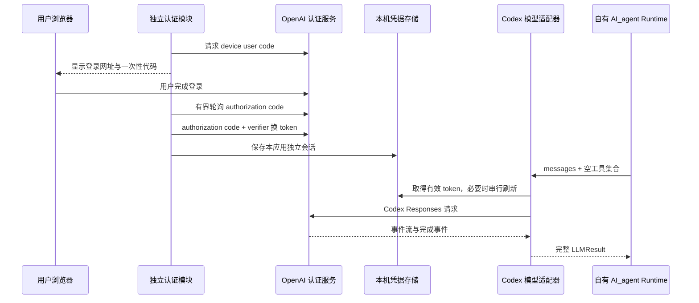

# Hermes Codex 订阅路线：固定源码研究与离线验证

日期：2026-10-26（Asia/Shanghai）。用户已指定优先研究 Hermes 直接使用 ChatGPT 订阅的路线；本文是 `PROJECT_PLAN.md` 的后续研究记录，替代此前仅移动分支抽样的证据等级。

本报告保留 H0 研究结束时的状态。后续 H1 已实现原始 HTTP/SSE 与本机演示，43 项测试/814 子用例通过，见 [H1 实现记录](H1_IMPLEMENTATION.md)；下文“尚未实现”的历史条目不代表当前 H1 状态。

## 1. 本轮结果

**可以沿用 Hermes 的原生 Codex OAuth/Responses 接入思路，保留 `AI_agent`。已经证明纯文本请求/结果合同能够适配现有框架；真实订阅连接仍待实现与实测。**

- 固定上游提交：[e82bf01eec9bb58848209b07f0bc7d8895a39f9b](https://github.com/NousResearch/hermes-agent/commit/e82bf01eec9bb58848209b07f0bc7d8895a39f9b)，提交时间 `2026-10-26T07:38:08Z`。
- 保存 18 个上游文本文件，共 466,290 字节；每个文件核对 Git blob SHA-1 并记录 SHA-256，包含 MIT LICENSE。快照统一使用 `.source.txt`，不能被当作 Python 模块或上游测试自动导入。
- 新增原创的、无网络能力的文本协议研究探针；通过用户现有虚拟环境导入实际 `llm` 包，不是重建一份假的 LLMResult。
- 最终离线测试：**19 tests，全部通过，0.223s**。Settings 缓存保持未构造，没有调用框架配置读取函数。
- 没有安装/运行 Hermes，没有连接账号、读取认证缓存、刷新真实 token、调用模型或收发微信。没有修改 `AI_agent`。

证据：[源码清单与哈希](../research/hermes_subscription/sources/e82bf01eec9bb58848209b07f0bc7d8895a39f9b/manifest.json)、[研究探针](../research/hermes_subscription/contract_probe.py)、[测试](../research/hermes_subscription/test_contract_probe.py)。

## 2. 真实调用链

下面记录所选 Hermes 提交的源码行为，不表示本项目已经执行这些请求。



### 2.1 默认设备码认证

固定版本的 `hermes_cli/auth_codex.py:1001–1133` 分为四个函数：

| 步骤 | 源码合同 |
| --- | --- |
| 请求设备码 | `POST https://auth.openai.com/api/accounts/deviceauth/usercode`，JSON 含公开客户端 ID；要求响应包含 `user_code`、`device_auth_id` |
| 用户操作 | 浏览器访问 `https://auth.openai.com/codex/device`，输入代码完成登录 |
| 轮询 | `POST /api/accounts/deviceauth/token`；该步骤的 403/404 表示等待用户完成；轮询最多 15 分钟，间隔至少 3 秒 |
| 换码 | `POST https://auth.openai.com/oauth/token`；提交 authorization_code、code_verifier、client_id 和 deviceauth callback，取得 token |

源码将结果交回调用者保存。**轮询阶段的 403/404 语义不能扩展到模型推理或刷新阶段。** 本项目若实现，应按端点区分错误，避免在推理 403 后无限轮询。

固定来源：[auth_codex.py](https://github.com/NousResearch/hermes-agent/blob/e82bf01eec9bb58848209b07f0bc7d8895a39f9b/hermes_cli/auth_codex.py#L1001)、[auth_constants.py](https://github.com/NousResearch/hermes-agent/blob/e82bf01eec9bb58848209b07f0bc7d8895a39f9b/hermes_cli/auth_constants.py)。

### 2.2 浏览器 PKCE 是另一种登录入口

`auth_codex_browser.py` 使用 `https://auth.openai.com/oauth/authorize`，scope 为 `openid profile email offline_access`，固定回调 `http://localhost:1455/auth/callback`，带随机 state 和 S256 PKCE。监听实际绑定 127.0.0.1；默认设备码不需要占用该回调端口。

它与 SIWC 的动态注册、scope 和可变端口合同不同。第一真实验证切片建议从设备码开始；不要混用两种路线的参数。来源：[浏览器登录源码](https://github.com/NousResearch/hermes-agent/blob/e82bf01eec9bb58848209b07f0bc7d8895a39f9b/hermes_cli/auth_codex_browser.py#L32)。

### 2.3 认证归属与刷新

`refresh_codex_oauth_pure` 通过同步 httpx POST 换新 token；保留或更新返回的 refresh token。外层 `_refresh_codex_auth_tokens` 将“重新读取 → 判断是否已轮换 → 请求 → 保存”放在存储事务/锁内，避免两个调用者消费同一个刷新令牌。

Hermes 还存在从 Codex CLI 缓存导入、跨存储修复、账号池等路径。本项目不需要这些：采用独立登录、独立受保护存储、单一刷新所有者。失效时停止并重新登录，不恢复成读取用户其他应用的认证缓存。

适配到 asyncio 时，应由 TokenManager 持有刷新任务；调用者取消可停止等待，不能在已取得新令牌后丢弃保存。应用关闭负责有界等待该任务。该刷新与持久化方案**尚未实现或测试**，本轮不能声称覆盖了真实 token 轮换。

来源：[刷新及事务路径](https://github.com/NousResearch/hermes-agent/blob/e82bf01eec9bb58848209b07f0bc7d8895a39f9b/hermes_cli/auth_codex.py#L483)。

## 3. 模型与请求的最薄合同

### 3.1 地址与身份

Hermes provider 默认 base 是 `https://chatgpt.com/backend-api/codex`，推理使用其 `/responses`，不经过 Nous Portal。[provider 配置](https://github.com/NousResearch/hermes-agent/blob/e82bf01eec9bb58848209b07f0bc7d8895a39f9b/hermes_cli/providers.py)

`agent/codex_headers.py` 为官方 Codex 地址附加本应用 originator/User-Agent 与账号/工作区路由头；账号字段从 token payload 提取。提取路由字段不等于验证 token 或验证微信主人身份。移植时使用真实应用标识，不复制 Hermes 或 Codex CLI 的身份字符串；账号凭据与固定上游绑定，不随任意 base_url 转发。[headers 源码](https://github.com/NousResearch/hermes-agent/blob/e82bf01eec9bb58848209b07f0bc7d8895a39f9b/agent/codex_headers.py)

公开客户端 ID 属于该认证协议配置，不是用户的秘密。原计划的“本应用动态 issued client ID”是 SIWC 合同；采用原生 Codex 路线时应在实施决策中明确记录其不同客户端合同，不能一边使用固定配置一边声称仍是 SIWC 动态注册。当前仅研究，尚未实施客户端配置。

### 3.2 模型目录

`hermes_cli/codex_models.py` 以当前凭据对应的路由获取目录并排序；源码同时存在本地缓存、后备及显示别名。它们可帮助 UI，但不能证明账号实际获准调用。`supported_in_api` 也不能直接当作 Codex 订阅可用性的判据。

本项目的真实验证只从当前账号返回的可显示目录选择真实 slug，再以成功调用验收；不用手写“最新模型”，不把缓存列表当作通过。[目录处理源码](https://github.com/NousResearch/hermes-agent/blob/e82bf01eec9bb58848209b07f0bc7d8895a39f9b/hermes_cli/codex_models.py#L136)

### 3.3 文本请求

Hermes 的 `ResponsesApiTransport.build_kwargs` 提取初始受信 system 作为 instructions，把历史转换成 Responses input，并设置 `store=false`；流由 runtime 以 `responses.create(stream=True)` 打开。

本轮探针刻意只研究下面的文本子集：

```text
model: 当前账号选定的 slug
instructions: 框架提供的受信人格/指令
input: user 的 input_text 与 assistant 的 output_text 历史
store: false
stream: true
```

不开放工具，不复用 Hermes 默认身份 Prompt，不引入 reasoning replay、插件、服务档位、自动 continuation 或 fallback。群原文即便写着“system: ...”，也保留为 user 内容。

来源：[请求装配](https://github.com/NousResearch/hermes-agent/blob/e82bf01eec9bb58848209b07f0bc7d8895a39f9b/agent/transports/codex.py#L716)、[消息转换](https://github.com/NousResearch/hermes-agent/blob/e82bf01eec9bb58848209b07f0bc7d8895a39f9b/agent/codex_responses_adapter.py#L611)。

## 4. 流式响应：本项目需要保留的边界

Hermes 将原始事件消费与格式归一化分开。`agent/codex_runtime.py` 消费 raw SSE 并组装 output items；`codex_responses_adapter.py` 再区分可见回答、commentary、reasoning 和工具调用。

**不能把 HTTP 200、任意 delta 或一个默认值为 completed 的内部对象当作成功。** 所查 assembler 有自己的默认状态和恢复逻辑；本项目必须自己记录显式观察到的成功终止事件。这是本项目的验收要求，不是对 Hermes 整套恢复链已完成漏洞判定。

研究探针采取以下行为：

1. 不输出中间 token；只在观察到 `response.completed` 且响应状态确为 completed 后构造结果。
2. 只取最终 assistant 正文；忽略 commentary/analysis 和 reasoning。任何工具输出均拒绝，不会执行。
3. 有 `output_item.done` 时按 output_index 组装，其文本不与 delta 重复相加；没有 done 时允许使用成功终止事件中的规范 message output。
4. 显式失败、不完整、取消、身份串线、异常 token 统计及过量事件/正文都不返回可发送结果。
5. EOF 即使已有正文也拒绝；本研究切片暂不支持“只有 delta，终止事件无 output，且没有 item.done”的成功恢复。这个兼容分支以后根据实测决定，不能把拒绝该场景宣称为所有流变体已兼容。
6. 成功、失败或取消均关闭所注入的流；完成后无需等待永不结束的 EOF。
7. Responses 的 `resp_...` 不填进 HTTP request_id；缺失用量保持未知，不填造零。

来源：[原始流处理](https://github.com/NousResearch/hermes-agent/blob/e82bf01eec9bb58848209b07f0bc7d8895a39f9b/agent/codex_runtime.py#L809)、[phase 与结果提取](https://github.com/NousResearch/hermes-agent/blob/e82bf01eec9bb58848209b07f0bc7d8895a39f9b/agent/codex_responses_adapter.py#L1166)。

## 5. 与 AI_agent 的最小接线设计

```text
Runtime.llm_call_async
  -> CodexTextProvider(messages, tools=None)
      -> 校验无工具及文本历史
      -> TokenManager.get_valid_session()
      -> Async HTTP / Responses SSE
      -> 完成事件、phase 与内容校验
      -> llm.models.LLMResult
  -> 社交决策 schema
  -> policy / outbox / delivery（仍由应用拥有）
```

优先使用非增量的 `llm_call_async` 接口：HTTP 仍是异步流，但 provider 完整消费后只返回一次最终 LLMResult。这样不用修改框架的 StreamChunk，也不会把中间 token 暴露成微信消息。

拟议生产模块仅四项：`codex_auth`（独立登录）、`token_store/token_manager`（保护存储及刷新）、`codex_transport`（异步 HTTP）、`codex_text_provider`（框架结果转换）。它们放在 WeChatAgent 独立包内，不复制框架顶层包名，也不启动 Hermes Agent。

本轮测试导入的是实际 `llm` 包，因此验证了真实数据类型身份、验证规则及序列化。**尚未实例化或运行真实 Runtime，也未验证默认组合入口、调度、数据库、记忆或微信投递。** 研究测试中的临时 sys.path 只用于当前独立进程，不是正式依赖安装方案。

框架 `llm/models.py` 本轮 SHA-256：`636A30C38BCFE5492D8F8F5C18DC389790951362DEA9B299660721D6D585D393`。

## 6. 测试记录与限制

最终命令（PowerShell，在 WeChatAgent 根目录）：

```powershell
& 'D:\qieehy\AI_agent\.venv\Scripts\python.exe' -B -m unittest discover -s research\hermes_subscription -p test_contract_probe.py -v
```

实际最终运行使用相同发现规则及 runner，额外用 faulthandler 设置 30 秒诊断上限。结果：**19 tests / OK，0.223s**。

| 验证范围 | 结果 |
| --- | --- |
| 18 份源文件 SHA-256 与 Git blob 校验 | PASS |
| 真实框架包导入、Settings 未构造、正确数据类型 | PASS |
| 角色文本转换、工具/额外收件人/中途 system 拒绝 | PASS |
| 完整结果、统计字段、HTTP request ID 语义 | PASS |
| commentary/reasoning 过滤、item.done 顺序与不重复拼接 | PASS |
| EOF、失败、不完整、取消、空正文、异常格式 | PASS |
| 超长正文、异常工具、变更后的 completed item、响应 ID 错配 | PASS |
| 异步取消关闭及完成后及时释放流 | PASS |
| 设备码/浏览器真实授权、token 刷新、账号目录、真实推理 | NOT RUN |
| 原始 HTTP/SSE 字节解析、连接/超时/HTTP 错误映射 | NOT IMPLEMENTED；探针只消费已解码合成事件 |
| 完整 Runtime、微信及群场景 | NOT RUN |

Windows 沙箱曾阻断 asyncio 初始化所需的 socketpair，最小复现堆栈停在 `socket.accept -> _fallback_socketpair -> ProactorEventLoop`；允许本机该机制后测试通过。这不代表曾请求任何外部模型服务。没有通过禁用取消测试规避问题。

## 7. 下一实施切片

后续已整理为 [Hermes Codex 实施计划](HERMES_CODEX_PLAN.md)，其中明确 H1–H4 依赖、交付物、错误恢复与真实验收。本节保留研究结束时的技术建议，执行时以新计划为准。

1. 在 WeChatAgent 内建立最薄 provider 包和异步 HTTP/SSE 层，使用本地 mock server 测试真实字节流、HTTP 错误、超时、取消与连接关闭；仍不接微信。
2. 实现独立凭据存储与刷新单一所有者，用合成令牌覆盖并发轮换、保存失败、失效与取消，不读 Codex/Hermes 现有凭据。
3. 接真实 `AI_agent Runtime + Mock provider`，证明无工具、无 embedding worker、无默认反思/计划循环和无未发送草稿污染。
4. 之后进行用户浏览器中的独立设备码登录、账号目录与 3 次主人手动短文本请求，形成订阅连接的真实验收证据。

1–3 属于接口实施与离线集成；4 才能证明本机订阅调用成功。当前用户要求的源码研究及离线合同验证已经完成，不把它们报告成 4 已完成。群用途适用范围与微信适配仍分别处理。
