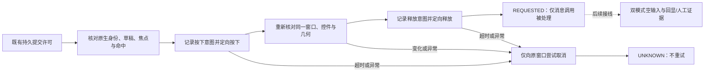

# W2-B7：窗口定向点击候选与独立接收窗口验证

2026-11-02。**窗口定向鼠标消息候选已实现，并在本程序自建的隐藏窗口中验证；没有接入微信发送。新增 36 项场景、相关回归共 108 项通过。原无效 Invoke 路径继续关闭，当前草稿与发送阻断保持不变，W2-B / V0 未通过。**

## 候选实现

新增 `bridges/wechat/directed_click.py`，只依赖注入的观察、发消息、取消和持久记录回调，没有默认 Win32 发送器、真实 UI 观察器、CLI 或工作台入口。它还不是可用的微信提交后端。

候选采用定向给同一 HWND 的一次 `WM_LBUTTONDOWN` / `WM_LBUTTONUP`，不使用全局鼠标移动、全局按键、双击、额外回车、`BM_CLICK` 或原来的 Invoke。它用于后续验证自绘控件的真实鼠标事件路线，不把标准按钮消息的行为套给 XSkiaWidget。

每次动作必须由父进程既有持久提交许可放行；候选内部还要求记录回调先完成对应意图，再调用消息回调。该记录接口尚未与真实账本接线，不能把测试用列表日志宣称为持久许可。

## 观察合同

`ClickSnapshot` 必须由受信原生观察器构造，不能来自模型建议或任意坐标输入。合同覆盖：

- 原有账号、规范 `filehelper`、窗口代际和输入控件；输入前的已核实空草稿快照、输入后的全文哈希必须一致。
- 按钮可见、启用，实际命中元素属于同一按钮、同一 PID 和主窗口；接收 HWND、UI 线程和前台窗口必须匹配。
- UIA 物理像素坐标、已确认的每显示器 DPI 上下文和 ScreenToClient 结果一致；按钮完整位于客户区内，点击点保留边缘余量。
- 支持屏幕负坐标与按钮的小数边界，但发入 LPARAM 的客户区坐标必须为 0–32767 的整数，拒绝缩放假设或截断溢出。
- 按下前没有其他捕获或用户按键/鼠标干扰；按下后只允许原窗口捕获，焦点可仍在输入框或转到同一发送按钮。

按下之后若账号、目标、输入、草稿、命中、焦点、DPI、按钮位置或 UI 线程发生变化，不向新目标释放，不重新定位另一个按钮继续执行。取消回调必须独立核对原始 HWND、进程代际和线程。

单个消息的时限为 1–250 毫秒，默认 150 毫秒。任何可能已经开始的按下/释放调用失败都返回 UNKNOWN；取消调用成功也不把它改为“未执行”。对象在第一次观察前即消耗单次使用权，同一个手势对象不能重放。调用方仍须提供完整操作时限和可终止工作进程；此模块不保证目标应用已经接收的请求能被撤销。

## 独立 Windows 接收实验

`tests/wechat_click_receiver.py` 创建无 ShowWindow/激活操作的隐藏自有窗口，只记录鼠标消息。测试发送器同时核对独有窗口类 `WeChatClickFixture_<PID>`、进程创建时间、线程及绑定，只允许这个测试接收器，不能拿微信 HWND 来使用。

真实 Win32 调用使用 `SendMessageTimeoutW`，启用 BLOCK、ABORTIFHUNG 和 ERRORONEXIT，不广播、不设置无限等待。窗口过程返回 0 仍被正确视作“API 调用被处理”，不误当失败。

三个实验均通过：

| 场景 | 结果 |
| --- | --- |
| 正常接收 | 隐藏窗口收到一次 DOWN、一次 UP，客户区坐标和标志完全一致；结果仅为 REQUESTED。 |
| DOWN 处理挂起 | 返回 UNKNOWN，尝试向原窗口取消，不再发 UP；没有重试。 |
| UP 处理挂起 | 返回 UNKNOWN，尝试取消，不再发另一组 DOWN/UP；没有重试。 |

原窗口身份或进程创建时间错误时，测试发送器在发消息前拒绝。三个接收进程都在 Job 中终止并核对活跃进程数归零，收尾查询没有残留测试接收器。

这只验证了消息格式、调用边界、错误处理与回收。没有证明微信的自绘控件接受这些消息，也没有证明 `WM_CANCELMODE` 能取消它的半个手势；不能据此放开微信发送。

## 修正 Windows 虚拟环境启动层

实验发现 `.venv\Scripts\python.exe` 的进程 PID 与真正运行脚本的 Python PID 不同。原来仅把启动器当作实际工作进程，不足以消除子进程是否及时继承 Job 的调度依赖；这不代表已经证明历史上有迟到动作。

`send_process.python_worker_command()` 现直接启动同版本的基础 Python，以隔离模式加载当前虚拟环境的 site-packages 和脚本目录，保留锁定依赖。初始化协议之前，Job 绑定的 PID 就是真正的工作进程；随后创建的 UIA 子进程继承同一 Job。`JsonSendWorker` 对当前环境的 Python 脚本命令自动使用该启动方式。

测试核对了脚本报告的 PID 等于父进程创建返回的 PID、虚拟环境前缀及 ai-agent/cryptography 版本保持一致，并验证包含空格、引号、美元符号、反引号和换行的参数原样传递。没有使用 Shell 拼接代码，没有安装或升级依赖，也没有修改当前终端/系统环境。

## 验证与当前状态

36 项新增场景包括错误目标/窗口/命中、失焦、草稿或控件变化、捕获/用户干扰、几何变化、负屏幕原点、小数边界、坐标溢出、两阶段超时、日志失败、部分动作中的中断及三个隐藏窗口实验。相关完整回归 **108 passed**；最后绑定参数加强后，针对新增 36 项复验通过，Ruff 通过。见 [离线证据](evidence/w2b7-offline-2026-11-02.json)与 [本轮汇总](evidence/w2b7-result-2026-11-02.json)。

本轮未访问微信进程内存、未临时启用微信可访问性、未输入/聚焦/点击微信、未清草稿、未调用模型或修改收藏。发件账本只读复查仍为 **3 个历史尝试、1 次输入许可、1 次提交许可、1 条人工确认**，通道仍为 `submission_or_draft_requires_review`，没有解除或改写。

下一项 W2-B8：实现只读的真实按钮几何/DPI/命中观察器，并核对窗口定向事件路由与取消行为。只有这些条件和当前草稿处理条件具备，才考虑独立的新动作验收；不得复用已确认动作或借此补发旧标记。现有真实后端继续拒绝原路径及未知替代路径。

依据为 Microsoft 官方 [鼠标消息与坐标](https://learn.microsoft.com/en-us/windows/win32/learnwin32/mouse-clicks)、[SendMessageTimeoutW](https://learn.microsoft.com/en-us/windows/win32/api/winuser/nf-winuser-sendmessagetimeoutw)、[UIA 缩放坐标](https://learn.microsoft.com/en-us/windows/win32/winauto/uiauto-screenscaling)、[线程 DPI 上下文](https://learn.microsoft.com/en-us/windows/win32/api/winuser/nf-winuser-setthreaddpiawarenesscontext)。这些 API 定义不代替本机微信兼容性证据。
