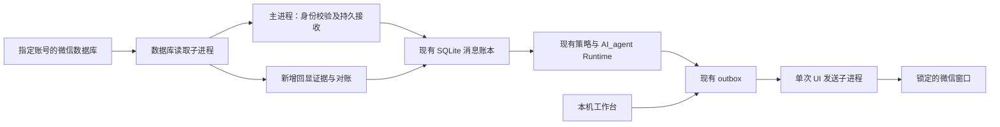

# 微信接入实施计划：参考 whale_gril，接入现有 AI_agent

> 当前（2026-11-16）：BG1 已于 11 月 11 日完成限定验收；文件助手工作台 E0–E7 已通过限定实机HTTP闭环：新来源、一次模型、编辑版本、单次后台发送、唯一回显、手机确认和重启无重放。范围仍为原账号/4.2.0.13/非最小化遮挡独立filehelper，主人私聊与群未验收。后续R1–R6已转入 [工作台实施计划](WORKBENCH_PLAN.md)；实际代码和测试见 [实施记录](WORKBENCH_IMPLEMENTATION.md)，实机证据见 [E7](E7_WORKBENCH_ACCEPTANCE.md)。下文保留原阶段设计与历史进展。

制定日期：2026-10-30；进度更新：2026-11-07。状态：**A 深层结构、B 合同/账本基础、C 限定账号正式接收已通过；D 的 W2-B17 受绑定真实鼠标单次试验已取得唯一新回显、延后独立空输入/按钮释放及手机完整标记确认，D / V0 限定收发 PoC 通过；前台物理输入及人工准备限制保留，E–F 待实施**。依据为 [whale_gril 固定源码评估](WHALE_GRIL_REVIEW_2026-10-30.md)和当前代码/证据。本文保留阶段设计，最新范围见 [阶段 C](W2A_C_RECEIVER.md)及 [W2-B17](W2B17_BOUND_PHYSICAL_CLICK.md)；历史证据不改写。

当前操作边界优先于下文远期发送验收：用户已同意继续，但**仅文件传输助手允许真实发送，不修改收藏等微信内容**。联系人/群的 V1/V2 发送只能保留为未来计划；本轮可做离线流程、观察及草稿功能。目标限制必须在发送器输入前强制执行，不能只依赖页面提示。详见 [操作范围](WECHAT_OPERATION_SCOPE.md)。

2026-11-07 优先级调整：先实施 [后台操作计划](BACKGROUND_OPERATION_PLAN.md) 的 B18–B21。BG1“不抢前台、不移动鼠标、被遮挡时收发”是后续可用版本的必需条件；前台物理 PoC 只作对照。BG1 通过前，E–F 的真实发送接线暂缓；离线准备和现有接收维护可继续。

## 1. 交付目标与第一版范围

第一版交付：一个本机微信账号、一个明确绑定的测试会话、纯文本，能够接收新消息、在工作台生成草稿，并执行一次可追踪的发送。首次固定文本验证可使用文件传输助手；主人私聊的入站验证另用实际发送方身份，不把文件传输助手等同于主人私聊。

按三个完成等级交付：

| 等级 | 用户可以做什么 | 通过条件 |
| --- | --- | --- |
| V0：真实接入 PoC | 指定会话接收一条文本、发送一条固定标记 | 账号/目标明确，接收去重，提交与回显可追踪，无模型调用 |
| V1：主人私聊助手 | 收到主人消息 → 生成草稿 → 确认发送；条件满足后再启用限定会话的自动回复 | 真实平台隔离、暂停/过期/新消息阻断有效，未知投递不重发 |
| V2：受控群聊 | 指定群先观察策略，再开放经过验证的明确 @/引用触发 | 群成员、@/引用身份和所用模型路线均通过场景验收 |

本轮不排期图片、语音、表情包、主动分享、游戏检测、多账号并行或桌面挂件。保留当前网页工作台；人格继续由现有 Persona 版本管理。whale_gril 的人格/前端可另开产品迭代，不混入微信兼容性验证。

## 2. 已有基础与具体缺口

| 现有基础 | 本次如何使用 | 尚缺什么 |
| --- | --- | --- |
| `scripts/verify_wechat_accessibility.py` 的固定指纹预检及恢复事务 | 已补目标进程代际绑定、采集参数和真实恢复验证 | 按任务运行的桥接生命周期尚待接线 |
| `scripts/probe_wechat_uia.ps1` 的独立进程超时 | 已定向绑定窗口，32 层/800 节点及已知角色识别 | 控件真实操作、账号与会话身份仍未验证 |
| `ConversationScope` / `IncomingEvent` | 继续作为平台无关消息合同 | DB 记录到账号/会话/消息身份的可验证映射 |
| `Ledger.accept()` / inbox/outbox | 仍是唯一消息账本 | 持久接收游标、观察模式、投递证据和迟到对账 |
| `SocialService` / `Adapter` | 新微信适配器接 `identity` 与 `send_text` | 当前 10 秒发送超时如何停止原生 UI 操作；适配器生命周期管理 |
| S2/S3/S4 工作台 | 复用认证、Persona、预览、回放、暂停 | 目前路由绑定 fake scope；须新增真实绑定和状态，不能简单把 fake 改成 wechat |

现有事实：4.2.0.9 的深层结构及恢复、原账号/filehelper 稳定身份、正式接收/去重/读取器恢复已验收。W2-B17 受绑定前台鼠标固定标记取得唯一新回显与手机确认，D / V0 限定 PoC 通过；原瞬时结束观察拒绝及三条旧 UNKNOWN 保留。后台发送尚未通过：W2-B16 是改造路径失败，尚未完整复现上游原版。后续先按后台计划独立复现完整链路，不能从这些结果推导后台不可行。所有 PID/HWND 仅为历史证据，后续重新定位和核对代际。

## 3. 总体结构与复用边界

- **主进程独占账本。** 当前 `Ledger` 已有进程锁；工作台、策略和调度共用一个 owner。DB/UI 子进程不打开该 Ledger，避免第二个进程把仍在发送的记录当成崩溃恢复。
- **原生操作在子进程。** 继续使用能结束并回收的工作进程，不把 `thread.join(timeout)` 当作取消。首版同一时间只允许一个 UI 发送操作。
- **IPC 保持简单。** 由父进程创建子进程，使用有长度上限的结构化请求/响应；绑定启动代际与操作 ID。先不增加 HTTP 网关、独立 Node 服务或分布式队列。
- **接收与发送分开。** 读取正常但 UI 不可用时，可在允许的会话继续观察；不得因此改用键盘/OCR 自动补发。
- **副作用前复核。** 模型只能生成内容，账号、收件人和是否执行由程序绑定。只有主进程持有发送许可，子进程退出后该许可失效。

参考 whale_gril 的 `uia_compat.py` 控件线索、桥接事件字段和 `sticker_transport.py` 的单次动作边界。重写其普通文本重试、弱确认、模糊名称路由和整套自动回复循环。初版不引入 OCR。

## 4. 阶段 A：W1-G1，验证深层控件

**目标：** 回答“指定主窗口内是否存在可用的会话列表和输入控件”，不读取会话内容。

修改现有两个诊断脚本，先离线完成参数与输出设计：

1. 由上层指定 PID、HWND 和进程创建时间；校验所属可执行文件、模块指纹和窗口归属，只采集该窗口。
2. 候选特征采用 `session_list`、`chat_input_field`、`mmui::MainTabBar`；允许 List、Edit、Custom、Pane 等实际控件形式。已知 AutomationId 只转为角色枚举输出，不保存未知 ID、Name、Value 或标题。
3. 默认 Raw View；必要时再取 Control View，不无条件重复两次完整遍历。深度上限初定 32、总节点上限 800、工作进程总时限 30 秒；这些是诊断上限，不是成功条件。优先遍历已发现的 Qt 容器分支，找到所需角色后停止扩展无关分支。
4. 输出分清 `found`、`not_found_complete`、`incomplete`、`provider_error`、`wrong_window`；触及深度/节点/时间上限不能报告“控件不存在”。叶节点恰好位于深度上限也不能直接认定有未访问子树。
5. 诊断默认不启用内存标志。真实观察若需要再次启用，使用现有恢复事务，实验范围绑定新脚本指纹、目标和参数；上一次单次授权不自动延续。

**产物：** 参数化探针、角色摘要、一次有依据的新版观测记录。

**验收：** 在合成结构中覆盖错误窗口/深层角色/截断，再做一次真实结构验证。只找到导航栏不等于可发送；输入框和会话定位能力分别列出。

**失败分支：** 已有具体错误再调整对应定位，不反复提高全树扫描上限。UIA 仍不可用时，记录准确缺口，转为接收/草稿辅助功能；不自动降级微信或启用 OCR 发送。

## 5. 阶段 B：W1-G2，确定接口和持久状态

本阶段可在没有微信主窗口时完成。计划新增 `src/wechat_agent/bridges/wechat/`，先按职责划分为 `contracts.py`、`identity.py`、`events.py`、`reader.py`、`sender.py`、`worker.py`；必要时将已验明的启用/恢复逻辑抽到 `accessibility.py`。实现时允许合并小模块，不为目录拆分增加抽象层。

### 5.1 身份和事件

| 合同 | 必需内容 | 失效条件 |
| --- | --- | --- |
| AccountBinding | 明确账号、DB 账号/数据库代际、PID/创建时间/HWND、EXE/DLL 指纹、绑定证据与代际 | 进程或账号变化、模块更新、证据矛盾 |
| ConversationBinding | account_id、规范会话 username、类型、显示名称映射、人工/自动绑定依据 | 目标变化、同名冲突、窗口重新绑定 |
| SourceEvent | 来源记录标识、账号/会话/发送者、时间、类型、正文、结构化 @/引用证据 | 必需身份缺失或同 ID 内容冲突 |
| DeliveryEvidence | action_id、绑定代际、是否已接触输入/提交、基线、本地新消息标识、确认类型 | 目标变化、证据无法唯一关联 |

事件映射原则：

- `scope = (wechat, account_id, dm/group, conversation_username)`；昵称不作权限键。
- 优先研究 server_id 的真实语义。若只能使用 shard/local_id，使用“账号 + 数据库代际 + 会话 + 分片 + local_id”的复合身份；数据库代际不随普通进程重启变化，重建/迁移时才重新核验。不得每次重启生成新代际导致历史消息重新入站。
- 发送者按本条消息所在分片映射；未知 sender 不替换成 `unknown` 后放行。
- `source_verified` 由适配器核验结果生成，不接受 UI/LLM 传入的布尔值。结构化 @/引用缺失时记未证实，不把 `@昵称` 正则当成明确 @。
- 重复 ID/同指纹是幂等重放；重复 ID/不同指纹是冲突并暂停该来源。相同正文/不同 ID 是两条合法消息，不能正文去重。

### 5.2 接收事务和观察模式

当前 `SocialService.prepare()` 接收后立即进入决策，因此新增受控接收入口，把“持久接收”和“是否调用模型”分开。

计划在现有 SQLite 中增加 `bridge_bindings`、`bridge_cursors` 和必要的接收处置记录；业务正文只保存在对应 inbox/观察记录，不另存一份全量原始 DB 转储。`Ledger.accept()` 的内部判定抽为可在同一事务中调用的逻辑，使消息落账/明确处置与游标推进一致。

- 按来源游标取有界批次，逐条持久记录接受、过滤或冲突后才确认读取进度。
- 未落账时崩溃：重放该批次，由 inbox 去重；已落账未回 ACK：同样幂等重放。
- 过期/自身回声/未许可会话等拒绝可以推进游标，但保存原因计数或最小处置标识，不无限卡住。
- 观察模式只记录指定会话，不生成 outbox、不调用模型，也不直接改现有策略为许可。
- 当前启动会取消中断的 RECEIVED/PROCESSING/BUFFERED：继续遵循“不自动补答”。接收事实保留，取消原因可见。
- 有界队列满或现有账本达到 10,000 条容量时停止继续接收并展示原因；不丢弃后伪造已消费水位。

游标按分片保留 `(sort_seq, local_id)`，或重读序号边界并依赖 inbox 去重；实现选择以实际数据库查询能力为准。规范消息键可以哈希为固定长度，以满足当前 identifier 的 128 字符限制；原始组成字段保存在来源证据中。

### 5.3 投递与对账

保留外部 `ReceiptStatus.CONFIRMED / NOT_SUBMITTED / UNKNOWN`，增加独立证据记录，不把丰富状态都塞进一个布尔返回值：

| 实际证据 | 适配器/账本结果 |
| --- | --- |
| 校验失败，尚未改变输入或触发发送 | NOT_SUBMITTED / FAILED |
| 已粘贴、可能留下草稿，或已尝试提交但无法确认 | UNKNOWN / UNCONFIRMED，并标记草稿/通道待处理 |
| 数据库出现基线后的本人匹配记录 | 保存 local_echo；确认语义未验明前仍为 UNCONFIRMED |
| 具有已验证的投递确认信号，或用户核对接收端后确认 | CONFIRMED，并保留证据种类和关联 |

新增“只追加证据/对账”的入口，使 UNCONFIRMED 可以在证据充分后变成 CONFIRMED，而不重新调用 send_text。人工确认凭据与微信实际消息 ID 分开；若没有可关联的微信消息 ID，不能用人工确认编号假装满足群引用匹配。

这一步需要修订现有 `finish_delivery()` 仅处理 SENDING 的限制；保留动作和尝试历史。自动确认标准在 PoC 中确定：不能仅因为字段叫 server_id、输入框清空或库里出现记录就认定对端送达。

**产物：** 合同、兼容迁移、接收游标、证据存储、fake reader/sender。此时默认启动仍不加载真实桥接库。

数据库从当前 schema 4 迁往下一版本前使用现有 SQLite backup 方式留存快照，迁移置于事务内。旧版程序不直接打开新版数据库；回退时另用迁移前备份，并保留新版文件中的新事件与 UNKNOWN 证据，不覆盖删除。前端继续显示实际迁移/停用状态。

### 5.4 UIA 启用的运行周期

W1-F 恢复后树已回到 3 节点，因此正式发送不能假定探测成功后控件会一直存在。计划采用**按任务短时启用**：父进程持有同一个已核验的微信进程句柄，记录原值，必要时临时启用，允许一个受控 UI 工作进程完成该任务，确认工作进程结束后恢复原值并回读。原来已启用则不擅自改回 0。

找窗/读取状态不隐式启用；不启用系统读屏，不使用上游自动重写 gate 的恢复循环。恢复失败时停用后续发送，独立记录启用状态与投递事实，不把已经发送的消息改称“未提交”。父进程崩溃等极端情况仍不能保证恢复；启动时看到未完成操作只报告并重新核验，不自动重放发送。

这一运行模式须绑定可审阅实现和明确目标。2026-11-02 用户已同意继续既定范围的操作，不逐条重复询问；临时启用仍须恢复，不能变为常驻启用。发送范围始终仅文件传输助手，不修改收藏等内容。

## 6. 阶段 C：W2-A，限定账号的真实接收

1. 固定实际依赖版本、wheel/源码哈希及许可；不使用 `>=1.2.7`。已有 1.2.8.1 参考源码不等于运行依赖已选定。
2. 优先采用已审查的最小依赖层；若不能通过明确配置约束自动选账号、广泛密钥扫描和缓存行为，则维护带来源说明的小型补丁，而非应用运行时 monkey patch。
3. 明确 DB 读取的账号/进程范围。构造器会读取密钥，不能把 `WeChatDB()` 当作无副作用探测。不得自动遍历其他账号作为解密失败回退。
4. 密钥优先驻留读取子进程内存；确需持久保存时复用本项目的 Windows 用户保护机制。禁用默认明文 keys.json、.bak 和全局稳定副本。解密副本如必需，放项目专用、仅当前用户可访问的缓存目录，定义退出/崩溃后的清理；失败保留明确状态。不得把缓存、密钥、聊天正文写入 evidence 或诊断日志。
5. 每次运行绑定明确账号与会话列表；读取新文本及必要身份字段，保存到同一主进程账本。默认从明确基线开始，不扫描全部历史作为启动动作。
6. 检查实际 sort_seq 分页和同序号边界，避免 `> last_seq` 在一页截断时漏同序号消息。尚未证明可分页时，宁可停止并记录未完整读取，也不跳过余项。

**真实验收：** 指定发送方发一条唯一标记文本，观察身份与正文映射；同份事件离线重放验证只落账一次；重启读取器验证游标恢复。此阶段真实模型、外部发送均为 0。

**退出条件：** 账号/会话/发送者可解释，数据库更新能被读取，未确认身份不进入自动处理。数据库不可读时，不宣布整项目失败；可继续完成工作台草稿辅助版，真实接收保持未验证。

**2026-11-03 完成：** 原账号/filehelper 的手机新标记正文及发送者核对、同批幂等重放、全新读取子进程恢复同一账号代际与持久游标均通过。正式接收实现及逐项证据见 [阶段 C](W2A_C_RECEIVER.md)。本阶段不等于后续主人/群接线或真实发送已完成。

## 7. 阶段 D：W2-B，单次文本发送

发送器状态顺序：

`PRECHECK → INPUT_TOUCHED → SUBMIT_ATTEMPTED → LOCAL_ECHO / UNCONFIRMED → CONFIRMED（有充分证据时）`

具体实施：

1. 主进程取得全局 UI 操作锁，固定 action_id、内容哈希、目标绑定代际和超时。父进程先持久记录阶段，再准许子进程进入下一阶段。
2. 首次 PoC 由用户打开指定测试会话；先验证窗口、账号、目标和空输入框。目标定位自动化在身份能力证明后扩展，首个发送实验不同时叠加搜索导航。
3. 不清除用户草稿。检查焦点、目标及内容状态后粘贴，发送前再次复核。失去焦点或出现其他草稿就停止。
4. 按已核验的微信发送方式只触发一次；不把 Enter 和 Ctrl+Enter 都试一遍。每个 action_id 最多一个提交许可，异常不换通道。
5. 回读绑定会话基线后的消息，要求来自本人、全文一致且能唯一关联；历史消息、前缀相同、其他发送者、其他会话都不能作为证据。
6. 超时先停止并回收子进程，再释放 UI 锁；发送许可失效。工作进程若不能确认退出，保持发送停用。已发生的 UI 动作不能撤销，保留 UNKNOWN。
7. 原生工作进程在粘贴后退出可能留下草稿：对该窗口设置待处理状态，禁止下一次自动发送，待用户处理或重新验证；不发全局快捷键自动清空。
8. 协调当前 `SocialService` 的 10 秒超时和 worker 内部时限，留出回收时间；不是单纯增大数字。不得让协程返回后原生线程仍继续发送。

**真实验收：** 一条固定唯一标记、一个明确会话、一次提交。记录本地回显和接收端核对结果；若未确认，当次实验到此结束，不再点“重试”。

**通过 V0：** 接收与固定文本提交各有证据；身份局限、确认能力和人工操作范围写清楚。此时尚未等于自主群聊可用。

## 8. 阶段 E：工作台与主人私聊 V1

在 `console.py` 和现有静态前端增加“微信接入”区域，服务端按绑定生成目标；保留现有 fake 沙盒路由语义。真实账本使用独立文件，例如 `.state/social/wechat.sqlite3`，与沙盒隔离。一个运行实例只拥有一个账本，不启动第二个进程争用。

界面仅呈现用户需要判断的信息：

- 当前账号和目标会话、接收状态、发送是否可用、需要处理的草稿/未知投递。
- 模式：仅接收、生成草稿、确认发送；限定自动回复在验证通过后显式启用。
- 暂停、解绑、近期消息与投递状态；状态区分“已生成”“已尝试发送”“本机已回显”“已确认”。
- 未确认条目允许查看证据和人工对账，不提供把原 action 直接重新提交的“重试”按钮。

接入实际 Runtime 前，先用 mock 跑一遍真实事件到草稿的接线；然后仅做一次主人私聊真实模型验收，不重跑 H4 认证/目录/传输。沿用 Persona 版本、120 秒草稿 TTL、新消息取消旧草稿、暂停和预算检查。人格预演入口继续是预演，不自动获得外部发送能力。

**通过 V1：** 用户能在工作台完成“看到指定主人消息 → 生成草稿 → 确认发送 → 查看状态”。如果自动身份/确认条件不够，就明确交付这个辅助版，后续再补自动化。

## 9. 阶段 F：W3/W4，真实群聊 V2

此阶段依赖前面身份与投递合同，不以“UIA 发送过一次”作为开始条件。

1. 一个指定群先只接收和运行本地策略，不调用真实模型，不发送。
2. 验证会话/成员身份，区分真正结构化 @、普通文本 `@昵称` 和引用对象；缺少对应证据就保持该触发关闭。
3. 复用现有 S4 的缓冲、冷却、配额和过期语义；把合成事件入口换成已验证的真实事件入口，不移植 whale_gril 的续聊/回怼/主动分享循环。
4. 使用既定模型路线的适用场景另行验收后，先预览一份候选，再在指定群验证一次放行。
5. 重开窗口、账号变化、暂停和提交后失联时不补刷消息。最后按项目基线做受控观察，观察期不是循环发送压力测试。

群成员/结构化 @ 暂不可取时，V1 仍可交付；V2 对应能力保持未验证，不用名称正则填补身份事实。

代码落点需要单独改造：当前 `group_admission`、`configure_group`、`GroupBuffer` 限定 fake，`GroupBuffer` 还要求 SyntheticModel。需抽出共享策略和明确的真实模式装配，保留沙盒入口原限制；不能只注册一个 WeChatAdapter 就声称真实群已接通。

## 10. 关键测试、工时与操作边界

按四类关键场景组织验证，每个切片只运行新增或受影响的场景；无需为字段/包装函数逐个写小测试：

| 类别 | 集中覆盖 |
| --- | --- |
| 结构与身份 | 登录窗/主窗、深度截断、同名目标、PID/HWND 复用、账号变化 |
| 持久接收 | 重放幂等、同 ID 冲突、相同正文不同 ID、落账/ACK 两侧崩溃、分页边界 |
| 单次投递 | 草稿/焦点变化、提交后异常、工作进程超时和迟到结果、错误回显、UNKNOWN 对账不重发 |
| 工作台闭环 | 真实/fake 隔离、暂停/新消息/过期阻断、观察模式零模型零发送 |

真实测试按目的分别计数：一次新版结构观察；一组限定会话接收与重启；一次固定文本提交；接线完成后一次主人私聊真实模型流程。失败后先定位和改代码，只有变更或新证据才重复对应实验。其余异常用 fake 时钟/子进程/数据库记录模拟，不消耗订阅或刷真实消息。

粗略实施工作量（不含等待登录、真实验证配合和兼容性排障；按半天为一个工作单元）：

| 阶段 | 估计 | 依赖 |
| --- | --- | --- |
| A 深层探针 | 1–2 单元 | 现有诊断脚本；真实部分需要新的明确实验范围 |
| B 合同与账本 | 2–3 单元 | 可与 A 的实机等待交错推进 |
| C 数据库接收 | 2–3 单元 | B、固定依赖及密钥/缓存方案 |
| D 单次文本发送 | 2–3 单元 | A/B，完整回显验证还依赖 C |
| E 工作台与主人闭环 | 2–3 单元 | C/D；界面布局可提前 |
| F 真实群与观察 | 初步 2–4 单元，另计基线观察期 | 结构化群事件、身份、投递及模型场景验证 |

因此 V0 约 **3.5–5.5 个有效开发日**，V1 累计约 **4.5–7 个有效开发日**；这是工作量估计，不是承诺完成日期。4.2.0.9 数据库兼容性、稳定窗口身份及投递确认语义是三个主要变量；若其中某项失败，优先交付已可用的辅助模式，再决定是否值得继续投入。

当前可以直接推进源码、离线合同、假数据和工作台准备。2026-11-02 已按授权完成深层结构实验，后续同类操作不反复确认；数据库读取仍需绑定明确账号及所需会话，发送仅限已核实的文件传输助手，不修改收藏等内容。准备具体工具与范围后按既定授权执行，超出范围则停止。

每个切片结束只报告：完成内容、一次关键验收结果、剩余缺口和下一项。若需要现场操作，先准备可审阅的工具、目标范围及内容，再提出一次具体请求。

## 11. 下一次实施的具体待办（2026-11-07 更新）

1. A 已通过：定向探针、恢复事务接线、关键离线验证及真实结构/恢复验证完成。保留有界广度优先遍历，未实现未经证实的分支剪枝；本次无截断，无需重复扩大采集。
2. B 合同与账本基础已实现并离线验证：接收/游标原子事务、观察模式、目标约束及证据对账。真实身份能力不是由合同本身证明，UI 发送器仍须复核输入目标。
3. C 已于 2026-11-03 完成：稳定账号级代际、分库轮转、明确压缩元数据处理、读取子进程及恢复入口已实现；两个分库真实基线、手机唯一标记、同批重放及全新子进程恢复验收通过，事后只读账本核对仅 1 条自身回声、无 inbox/outbox/发送尝试。见 [阶段 C](W2A_C_RECEIVER.md)。
4. D / W2-B1 发送控制层已实现并离线验证：持久许可、按任务启用/恢复、可回收子进程协议、双侧目标/草稿/焦点复核、本机固定标记和严格回显关联。没有默认真实 UI 后端，也没有发送微信消息；见 [W2-B1](W2B_SINGLE_SEND.md)。
5. W2-B2 已完成有界原生输入能力取证：147 节点、唯一输入框、草稿读取和发送按钮候选；恢复与独立复查通过。已查字段未建立规范会话身份，仍未实现或开启真实 UI 发送。见 [W2-B2 结果](W2B2_INPUT_CAPABILITIES.md)。
6. W2-B3 按原生身份路线继续：无密钥账号复查通过，UIA 选中行到 Qt 原生对象的有界映射已验证；对象名/已查文本接口/具名属性仍未给出规范会话键。见 [W2-B3](W2B3_NATIVE_IDENTITY.md)。
7. W2-B4 当前输入页规范身份已验证：原生 ChatMessagePage 业务键精确匹配 filehelper，选中行与输入框同属当前主窗，账号与 W2-A 页认证证据一致。可复用检查、静态复现、25 项相关测试、临时恢复及独立收尾检查通过。见 [W2-B4](W2B4_CURRENT_SESSION_KEY.md)。
8. W2-B5 后端、原生动作前复核、持久聚焦许可、分阶段时限和两个固定分片快照基线已实现。仅一次请求获文本输入/提交许可，用户手机确认完整标记已登记；63 项相关测试通过。自动数据库回显未成立，ValuePattern 提交后仍返回标记，发送通道保持阻断，V0 尚未全部通过。见 [W2-B5](W2B5_NATIVE_SINGLE_SEND.md)。
9. W2-B6 已通过只读核查定位实际按钮的 ActionInterface 只处理 SetFocus、不实现 Press；原路径已在输入前关闭，提交后双模式空输入校验已补齐。72 项相关测试通过，没有新动作或账本更改，人工确认和通道阻断保留。见 [W2-B6](W2B6_POST_SUBMIT_DIAGNOSIS.md)。
10. W2-B7 窗口定向点击候选及三个隐藏自有窗口实验通过，当前 venv 工作进程已改为直接启动，相关回归 108 项通过。候选没有真实微信观察器/发送器，不注册到发送服务，草稿及通道阻断保持不变。见 [W2-B7](W2B7_DIRECTED_CLICK_CANDIDATE.md)。
11. W2-B8 已通过真实几何/DPI 只读观察，静态复现 QWidget 事件到 XOutlineButton 信号；135 个不同用例通过。前台/命中/焦点当前不满足，未调整窗口；草稿保持、租约恢复及独立复查通过。真实窗口路由和自绘状态取消未验证，发送继续关闭。见 [W2-B8](W2B8_READONLY_GEOMETRY_AND_ROUTE.md)。
12. W2-B9 已只读核实当前按钮唯一 clicked 连接进入同一输入区域的 Send(3)，固定 DLL 的窗口类注册及取消默认路线可复现；新增 34 项、相关 108 项通过。实际窗口过程读取被错误 5 拒绝，原生过滤器/自绘状态清理仍未验证，鼠标候选和真实提交继续关闭。租约恢复、草稿保持及独立复查通过。见 [W2-B9](W2B9_CLICKED_CONNECTION_AND_CANCEL_ROUTE.md)。
13. W2-B10 仅解析磁盘 DLL，复现回车过滤分支、send 到 Send 的静态连接，以及字符事件键值和按键记录路径；所查三类单消息键盘候选均未通过资格检查。12 项新增静态验收及 2 项拒绝回归通过，未访问微信进程或执行输入。见 [W2-B10](W2B10_KEYBOARD_ROUTE_QUALIFICATION.md)。
14. W2-B11 持久手势合同已实现。2026-11-04 的 W2-B12 一次获批新标记试验发生按钮状态异常，没有 UP 意图或唯一新回显；手机未收到、电脑草稿保留，许可已消费，新动作 UNKNOWN/UNCONFIRMED、通道重新阻断，D / V0 未通过。按用户建议重读并固定最新上游后，发现 whale_gril 新增独立后台发送器及 4.2.0.9 实测报告，其 MOVE→DOWN→等待→UP 和 PostMessage 交付与本次实现有具体差异。下一项优先基于该模块做最小点击序列适配和离线验证，暂停扩展自研逆向；同时明确旧 UNKNOWN/草稿的人工对账合同。不删除按下位复核、不清草稿、不换进程或账本绕过、不重发。见 [上游适配调整](UPSTREAM_SEND_ADAPTATION_2026-11-04.md)及 [W2-B12 结果](W2B12_REVIEWED_TRIAL.md)。

15. 用户同意上游适配方案后，W2-B13 已实现可注入排队点击组件、MOVE 的父进程持久确认、按下位有界等待、ACK 后复核、入队/处理/取消状态区分及 MOVE 中断恢复。新增 33 个关键场景，全量 388 项及 848 子场景通过；自建隐藏窗口证实入队不等于处理，原发送账本只读保持。下一项连接受绑定原生投递及观察器、补齐提交后状态，并处理旧 UNKNOWN/草稿的独立人工对账。没有注册新真实入口、不清草稿或重发，D / V0 仍未通过。见 [W2-B13](W2B13_UPSTREAM_POSTED_ADAPTER.md)。

16. W2-B14 已完成受绑定 PostMessage 后端及实际投递前的再次核对，UP 后有界观察同一编辑器两模式为空、按钮释放/捕获归零。新后端仅接受新固定标记，不自动聚焦、清草稿或回退；旧默认/定向路线保留。逐条未知历史复核须有明确 action/ref，原 UNKNOWN 不改送达，旧进程退出/新代际/空输入等条件仍须满足。全量 445 项及 848 子场景通过，收尾审核/控制器 42 项复验通过；只读现场核验原账号/filehelper，首次约 4.64 秒、预热后约 125ms。没有新真实发送，原账本/阻断保持。下一项按用户明确决定处理旧试验草稿、完整重启微信并批准具体新单条方案后验收，不从“继续”推定新消息许可。见 [W2-B14 具体方案](W2B14_POSTED_NATIVE_TRIAL.md)。

17. （历史准备状态，已由第 18 项的实际消费结果替代。）用户明确批准 B14 单次新标记及旧不确定性复核，引用 `user-bbe24a5ff9be49628ffcda50b0a16344`，并报告已重启准备好。新进程/原账号/固定程序核验通过，但当时前台不是所选微信进程。读取认证后输入前等待到 60 秒上限，程序退出并恢复；当时没有新复核/action/许可消费，账本为 4 次操作、各 2 次历史许可，未重复索要批准。旧等待和 nonce 随之作废。见 [批准后等待审计](evidence/w2b14-approved-wait-audit-2026-11-04.json)。

18. 上项是批准后的早期等待快照，许可现已在唯一实际试验中消费。用户“开始检查”后，为前台准备增加只读等待方式（相关 65 项通过，不激活或放宽检查），但仍遇前台不足；再明确告知并进行一次原账号/filehelper/空输入受绑定聚焦准备后，所有前置通过，才进入一次新输入与提交。MOVE/DOWN 入队，按下位未观察到，未继续 UP，尽力取消只记入队；手机未收到、新草稿哈希匹配，未重试/清理。账本现为 5 次操作/尝试、2 次结束复核、累计各 3 次输入/提交许可，历史手机确认仍 1 条，新旧未知均 UNCONFIRMED、通道重新阻断。独立 gate 0、账号和进程退出/完整性检查通过。下一项仅离线对照上游完整初始化和实际事件/状态采样缺口，不强行删除守卫或复用已消费许可。见 [B14 最终单次结果](W2B14_POSTED_NATIVE_TRIAL.md)。

19. W2-B15 完成离线初始化/点击时序对照及按下采样错误分类修正：原错误同时包含及时假值、读取超时、调度超时和轮数上限，现分别报告；期限和所有放行条件保持。新增 8 个慢读取/调度/目标变化场景，相关 113 项通过，Ruff 通过。不能由此反推 B14 根因；本轮未访问微信或真实账本。下一项准备只读分阶段观察耗时工具，明确状态采样时刻，再决定是否需要新的现场动作方案。见 [W2-B15](W2B15_PRESS_OBSERVATION_DIAGNOSIS.md)。

实际功能状态以 [源码评估](WHALE_GRIL_REVIEW_2026-10-30.md)、[W1-F 实验](W1F_CONTROLLED_VERIFIER.md)及后续各切片证据为准；本文列出的模块、表和界面属于计划项。
